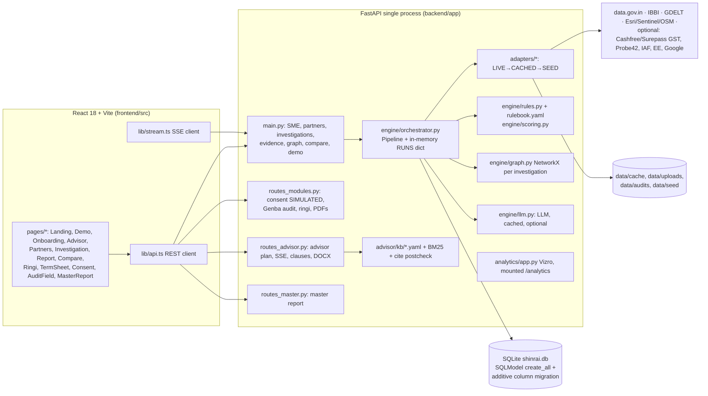
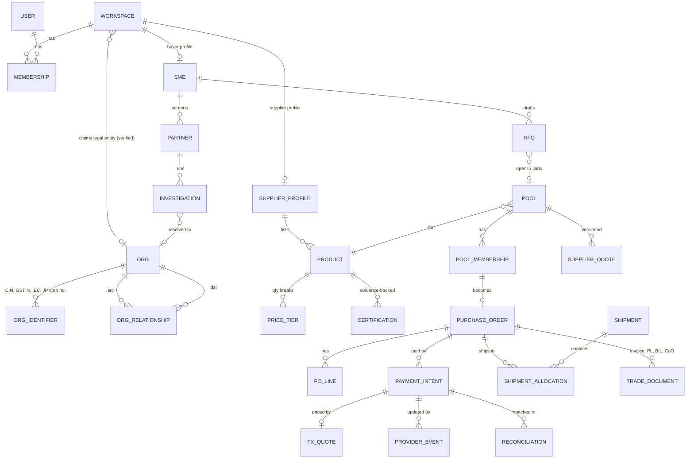
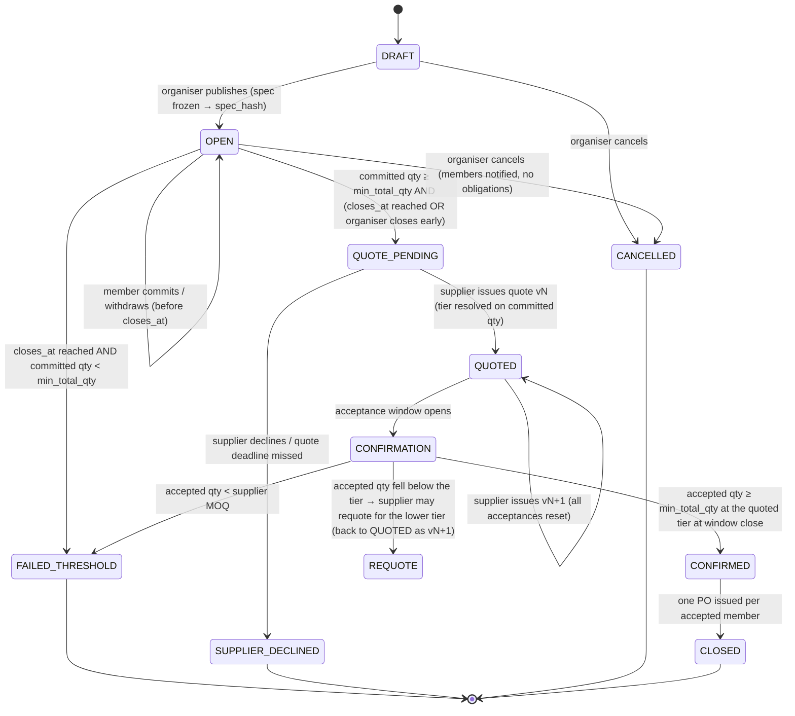
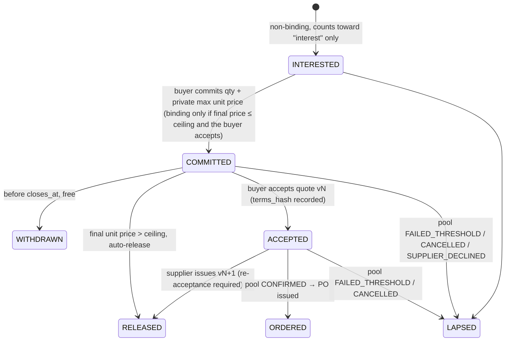
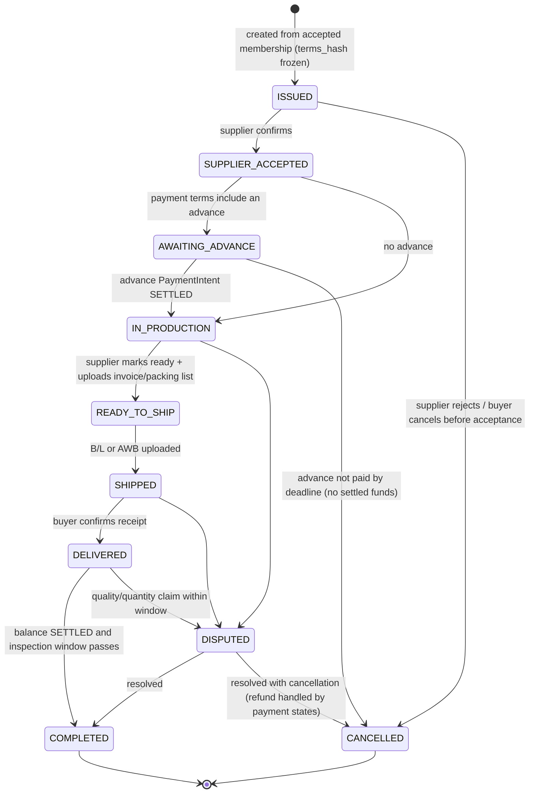
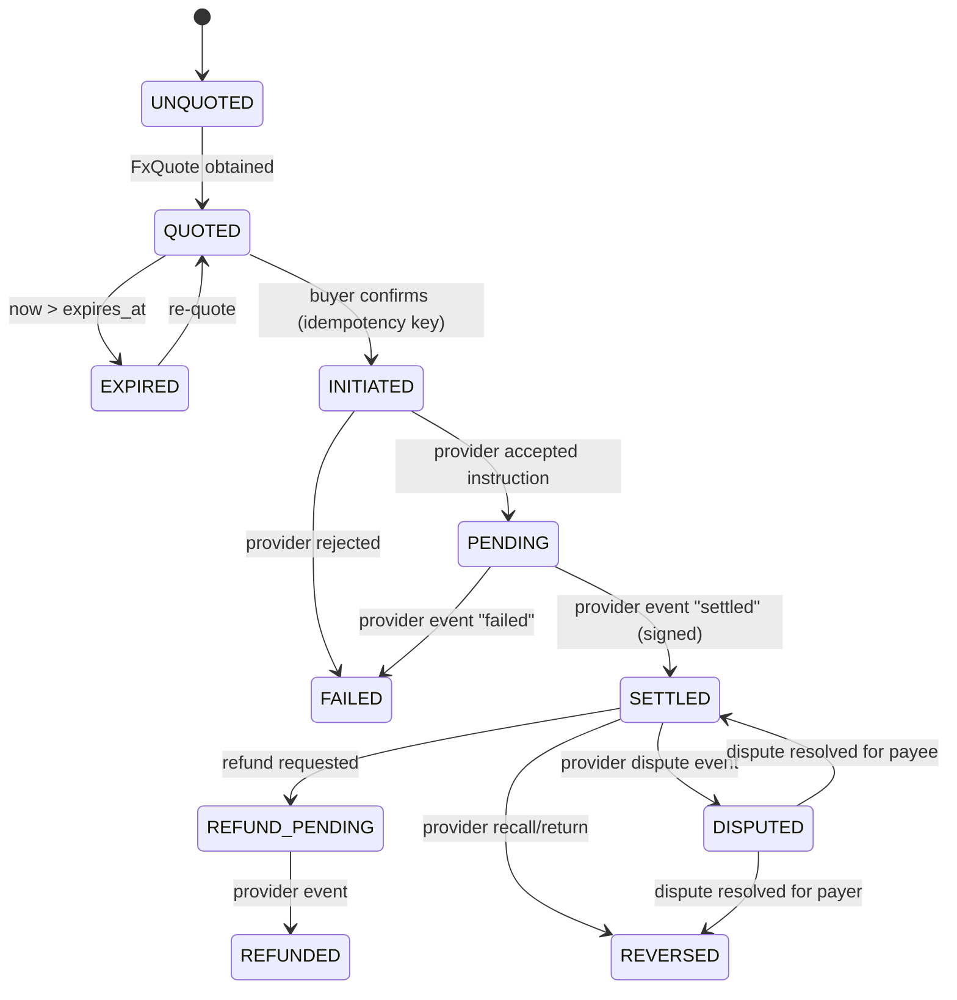

# Shinrai 信頼: Architecture Proposal for Trust-Backed Procurement

Status: proposal, not implemented. Audited against commit `ad8ddb3` (main, clean tree), 2026-10-25.
Companion documents: [UPGRADE_PLAN.md](UPGRADE_PLAN.md) · [IMPLEMENTATION_CHECKLIST.md](IMPLEMENTATION_CHECKLIST.md) · [RESEARCH_AND_COMPLIANCE.md](RESEARCH_AND_COMPLIANCE.md)

---

## 1. Design principles

1. **Extend, don't replace.** FastAPI, SQLModel, SQLite (Postgres later), NetworkX, React/Vite/TS, the SSE machinery and the rulebook all stay. Nothing measured so far justifies a new database, queue or service.
2. **Investigations stay investigation-scoped.** `Entity`/`Edge`/`Evidence`/`TraceEvent` keep their current meaning. The commercial layer gets its own durable tables and reads investigations only through a projection.
3. **Domain records are the source of truth for money and orders.** Every pool, order and payment change writes a row and an append-only `DomainEvent`. `TraceEvent` is never used for commercial state.
4. **Shinrai does not hold funds or act as a counterparty in the MVP.** Payments go through a provider abstraction. The only provider built for the hackathon is `simulated`, and it is labelled SIMULATED everywhere.
5. **Every displayed claim has a provenance class**: `LIVE`, `CACHED`, `ILLUSTRATIVE` (the current UI label for SEED), `SIMULATED`, `USER_REPORTED`, `PLATFORM_OBSERVED`, `ESTIMATE`, `UNKNOWN`.
6. **Tenancy comes first.** Pooled procurement is cross-tenant by nature, so workspace isolation has to exist before the first RFQ is stored.

---

## 2. Current architecture (as built)



Facts that constrain the design (each verified in source):

| Fact | Evidence | Consequence |
|---|---|---|
| Single process holds live runs in memory | `backend/app/engine/orchestrator.py:70` `RUNS: dict[int, Run]` | Only one uvicorn worker works. Fine for a pilot. Multi-worker needs Postgres LISTEN/NOTIFY or Redis pub/sub. |
| Schema is created with `create_all`, and migrations only add columns | `backend/app/models.py:214-233` | New tables are free. Renames, constraints and type changes need Alembic, so add it before Postgres. |
| Graph IDs are deterministic | `engine/graph.py`: `c_{CIN}`, `p_{DIN}`, `a_{hash}` | Projecting investigation nodes into a global org graph is straightforward. |
| Evidence IDs are per investigation (`ev_1…`) | `orchestrator.py:164-176` | A global relationship has to reference `(inv_id, ev_id)`, never `ev_id` on its own. |
| No auth, no tenancy | No `Depends`, no user model. `GET /api/sme` lists every SME (`main.py:93`) | This blocks any feature that stores private commercial data. |
| Money values are floats in the simulated money module | `routes_modules.py:83-97` (`float`, `/ 1e7`) | That is acceptable for display of simulated data, but the new code needs integer minor units. |
| PDF via Playwright printing frontend routes | `routes_modules.py:612` | The same approach can render POs and RFQ summaries, but depends on the frontend running on port 5173. |
| Pitch says PostgreSQL. Code is SQLite. | PDF p.4 "STACK FastAPI · PostgreSQL" vs `models.py:211` | Documentation and source disagree. Plan Postgres for the pilot and keep SQLite for the hackathon. |

---

## 3. Proposed architecture

```mermaid
flowchart LR
  subgraph Browser["React (existing app + new routes)"]
    BP[Buyer: /source, /rfq/:id, /pool/:id,<br/>/orders/:id, /pay/:id]
    SP[Supplier (mobile-first): /s/catalogue,<br/>/s/rfq/:id, /s/orders/:id]
    OP[Ops: /ops/verification, /ops/payments]
    EXIST[Existing: Advisor, Verify, Report…]
  end
  subgraph API["FastAPI single process"]
    AUTH[auth.py: session token → Principal<br/>workspace scoping dependency]
    VER[Existing verification engine<br/>orchestrator · rules · adapters]
    CAT[catalogue/: SupplierProfile, Product,<br/>PriceTier, verification badge]
    POOL[procurement/: RFQ, Pool, Membership,<br/>Quote, PO · state machines]
    LC[procurement/landed_cost.py<br/>pure functions, Money type]
    PAY[payments/: Provider protocol,<br/>simulated provider, webhooks, reconciliation]
    LOG[logistics/: Shipment, TradeDocument]
    CG[graph_global/: Org, OrgRelationship,<br/>projection from investigations]
    EV[events.py: DomainEvent append-only,<br/>hash-chained, idempotency keys]
  end
  DB[(SQLite → Postgres)]
  PP[Regulated payment partner<br/>(future; not built)]
  BP & SP & OP --> AUTH
  AUTH --> CAT & POOL & PAY & LOG & CG
  EXIST --> VER
  CAT --> CG
  VER -- "projection after persist()" --> CG
  POOL --> LC
  POOL & PAY & LOG --> EV --> DB
  CAT & CG & VER --> DB
  PAY -. "future HTTPS + signed webhooks" .-> PP
```

### 3.1 Module layout (follows the repo's existing pattern of `routes_*.py` plus packages)

```
backend/app/
  auth.py                    # Principal, session tokens, require_member(workspace_id, role)
  events.py                  # DomainEvent append, idempotency helpers
  money.py                   # Money (int minor units + ISO currency), FX conversion, allocation
  catalogue/models.py        # SupplierProfile, Product, PriceTier, Certification
  catalogue/badge.py         # verification level from investigations (deterministic)
  procurement/models.py      # Rfq, Pool, PoolMembership, SupplierQuote, PurchaseOrder, PoLine
  procurement/pool.py        # state machine + pure transition functions
  procurement/landed_cost.py # pure, explainable cost lines with status
  payments/models.py         # FxQuote, PaymentIntent, ProviderEvent, Reconciliation
  payments/provider.py       # Provider protocol
  payments/simulated.py      # SIMULATED provider (HMAC-signed webhooks to ourselves)
  logistics/models.py        # Shipment, ShipmentAllocation, TradeDocument
  graph_global/models.py     # Org, OrgIdentifier, OrgRelationship
  graph_global/project.py    # investigation → Org/OrgRelationship projection
  routes_auth.py  routes_catalogue.py  routes_procurement.py  routes_payments.py  routes_logistics.py
```

All new model modules must be imported in `models.init_db()` (or in `main.py` before `init_db`) so that `SQLModel.metadata.create_all` sees them. This is the single wiring point that is easy to miss.

---

## 4. Data model

Conventions: `id` is an integer primary key, as in the existing code. Externally visible records also carry `ref` (a ULID string, unique, used in URLs and idempotency) so integer IDs don't leak enumeration. Money columns come in pairs, `*_minor: int` and `*_ccy: str(3)`. Rates are `Decimal` stored as `TEXT` (SQLite has no exact decimal; the Postgres target is `NUMERIC(20,10)`). Timestamps are UTC.

### 4.1 Scope of identifiers

| Record | Scope | Why |
|---|---|---|
| `Org`, `OrgIdentifier` | **Global** | One legal entity, many workspaces and investigations |
| `OrgRelationship` | Global row with per-row `visibility` | Public-record edges are global. Platform and user edges are restricted. |
| `Workspace`, `Membership`, `User` | Global | Tenancy root |
| `Sme` (existing) | Workspace (add `workspace_id`) | Buyer profile |
| `Partner`, `Investigation`, `Entity`, `Edge`, `Evidence`, `Flag`, `Claim`, `TraceEvent` (existing) | Investigation (owned by a workspace through `Sme`) | Unchanged |
| `SupplierProfile`, `Product`, `PriceTier`, `Certification` | Supplier workspace, publicly listable when `published` | Catalogue |
| `Rfq` | Buyer workspace | Private requirements |
| `Pool` | Cross-workspace, membership-gated | Shared terms, private quantities |
| `PoolMembership` | The member's workspace (plus aggregate visible to pool) | Quantity privacy |
| `SupplierQuote` | Pool (and supplier workspace) | Versioned, immutable |
| `PurchaseOrder`, `PoLine` | Buyer–supplier pair | Bilateral contract record |
| `FxQuote`, `PaymentIntent`, `ProviderEvent`, `Reconciliation` | Purchase order | Payment trail |
| `Shipment`, `ShipmentAllocation`, `TradeDocument` | PO (allocation for a shared shipment) | Logistics |
| `DomainEvent` | Aggregate (pool, PO, payment…) | Audit |

### 4.2 Entity–relationship diagram



### 4.3 Entity specifications

Only the essential fields are listed. Each table also has `created_at`, `updated_at` and `ref` where noted.

**Workspace** `id, ref, kind(buyer|supplier|ops), name, name_ja, country(JP|IN), org_id?, verification_level(0-3), is_demo` · index `(kind, country)`
**User** `id, email unique, display_name, locale(ja|en), password_hash | magic_link_only` · for the hackathon, seeded demo users with a persona switcher
**Membership** `user_id, workspace_id, role(owner|buyer|approver|supplier_admin|ops)` · unique `(user_id, workspace_id)`

**Org** (global legal entity) `id, ref, country, legal_name, legal_name_ja?, status, status_source_ev(inv_id, ev_id)?, first_seen_at, last_verified_at, is_demo`
**OrgIdentifier** `org_id, scheme(CIN|GSTIN|IEC|PAN_MASKED|JP_CORP_NO|LEI), value, verified(bool), source_kind, evidence_ref` · unique `(scheme, value)`. PAN is stored masked only (it is personal or sensitive for proprietorships).
**OrgRelationship** `id, src_org_id, dst_kind(org|person), dst_org_id?, dst_person_key?, type, valid_from?, valid_to?, observed_at, source_kind(PUBLIC_RECORD|CONSENTED|PLATFORM_OBSERVED|USER_REPORTED|INFERRED), evidence_ref JSON{inv_id, ev_id} | {domain_event_id}, validation_status(verified|reported|inferred|stale|disputed), confidence(0-1)?, visibility(public|parties|workspace|ops), visible_to_workspace_ids JSON, is_demo` · index `(src_org_id, type)`, `(dst_org_id, type)`, `(type, visibility)`

Allowed `type` values and the rules that govern them:

| Type | Source kinds allowed | Default visibility | Notes |
|---|---|---|---|
| `DIRECTOR_OF` (person→org) | PUBLIC_RECORD | public | Projected from investigation `director_of` edges. `valid_to` set if the record shows cessation. |
| `SUBSIDIARY_OF` / `OWNS` | PUBLIC_RECORD, USER_REPORTED | public / workspace | Beneficial ownership is **not** inferred. |
| `REGISTERED_AT` | PUBLIC_RECORD | public | |
| `VERIFIED_SUPPLIER_FOR` (org→product category) | Derived from badge | public | Expires with the badge (180 days). |
| `SOURCES_FROM` (buyer org→supplier org) | USER_REPORTED | workspace | Never shown to others unless both parties opt in. |
| `POOL_MEMBER_OF` | PLATFORM_OBSERVED | parties (pool members see only "N buyers") | |
| `ORDERED_FROM` | PLATFORM_OBSERVED | parties | Aggregate "N completed platform orders" is public only with supplier consent. |
| `SHIPPED_VIA` | PLATFORM_OBSERVED, USER_REPORTED | parties | |
| `PAID_VIA` | PLATFORM_OBSERVED | parties | Stores provider and reference, never credentials. |

**SupplierProfile** `workspace_id unique, org_id, display_name, display_name_ja?, states[], capabilities[] (controlled vocabulary), export_experience(none|indirect|direct), iec_status(unverified|verified), languages[], published(bool), last_badge_inv_id?`
**Product** `id, ref, supplier_workspace_id, title_en, title_ja?, category, spec JSON (schema per category), hs_code_proposed?, hs_status(unverified|broker_confirmed|advance_ruling), origin_country='IN', unit(pcs|kg|m|set), moq_qty, lead_time_days, incoterms_offered[], published, is_demo` · index `(category, published)`
**PriceTier** `product_id, min_qty, unit_price_minor, ccy(INR|USD|JPY), incoterm, valid_until, source(supplier_list|quote)` · unique `(product_id, min_qty, incoterm)`
**Certification** `product_id | supplier_workspace_id, standard, cert_no, issuer, valid_until, status(claimed|register_verified|expired|contradicted), evidence_ref`. This reuses the `cert_check` adapter verdicts.

**Rfq** `id, ref, buyer_workspace_id, product_id? | free_spec JSON, category, qty, unit, target_unit_price_minor?, ccy, max_unit_price_minor (ceiling, private), destination_port(JP code), delivery_window_start/end, incoterm_requested, certs_required[], quality_standard?, notes, status(draft|submitted|pooled|closed)`
**Pool** `id, ref, product_id, supplier_workspace_id, organiser_workspace_id, spec_hash (frozen compatibility key), incoterm, destination_port, delivery_window_start/end, opens_at, closes_at, min_total_qty, max_total_qty, status, current_quote_id?, organiser_role='facilitator'` · index `(status, closes_at)`, `(product_id, status)`
**PoolMembership** `id, pool_id, buyer_workspace_id, rfq_id, qty, max_unit_price_minor, ccy, state, committed_at?, accepted_quote_id?, withdrawn_at?, reason?` · unique `(pool_id, buyer_workspace_id)` · CHECK `qty > 0`
**SupplierQuote** `id, pool_id, version, tiers JSON [{min_qty, unit_price_minor, ccy}], incoterm, valid_until, payment_terms(advance_pct, balance_terms), lead_time_days, terms_hash (sha256 of canonical JSON), status(draft|issued|superseded|withdrawn)` · unique `(pool_id, version)`. Rows are immutable once issued, and any change creates a new version.
**PurchaseOrder** `id, ref (PO number), buyer_workspace_id, supplier_workspace_id, pool_id?, quote_id, terms_hash, incoterm, currency, subtotal_minor, status, buyer_is_importer_of_record=true, issued_at, accepted_at?, is_demo`
**PoLine** `po_id, product_id, qty, unit_price_minor, ccy, line_total_minor`

**FxQuote** `id, ref, provider, sell_ccy(JPY), buy_ccy(INR), rate TEXT (decimal string), inverse_rate TEXT, buy_amount_minor, sell_amount_minor, fee_minor, fee_ccy, quoted_at, expires_at, provider_quote_id, is_simulated`
**PaymentIntent** `id, ref, po_id, provider, purpose(advance|balance|full), amount_minor, ccy, fx_quote_id?, state, idempotency_key unique, provider_payment_id?, supplier_invoice_ref, created_by_user_id, is_simulated` · index `(po_id, state)`
**ProviderEvent** `id, provider, provider_event_id unique, payment_intent_id?, type, payload JSON, signature_valid bool, received_at, processed_at?` (append-only)
**Reconciliation** `id, payment_intent_id, expected_minor, received_minor?, ccy, status(matched|short|over|unmatched), provider_statement_ref?, reconciled_at`

**Shipment** `id, ref, mode(sea_lcl|sea_fcl|air|courier), carrier?, forwarder?, origin_port, dest_port, etd, eta, status(planned|booked|departed|arrived|cleared|delivered|exception), consolidated bool`
**ShipmentAllocation** `shipment_id, po_id, chargeable_weight_kg TEXT, cbm TEXT, freight_share_minor, ccy` · unique `(shipment_id, po_id)`
**TradeDocument** `id, po_id, kind(commercial_invoice|packing_list|bill_of_lading|air_waybill|certificate_of_origin|insurance|inspection_report|other), file_path, sha256, uploaded_by, verified_status(unchecked|checked|mismatch), is_demo`

**DomainEvent** `id, aggregate(pool|membership|quote|po|payment|shipment|org_rel), aggregate_id, seq, type, actor_user_id?, actor_workspace_id?, payload JSON, occurred_at, prev_hash, hash` · unique `(aggregate, aggregate_id, seq)`. Append-only, enforced in code; on Postgres also by a trigger that rejects UPDATE/DELETE. Each row hashes `prev_hash + canonical(payload)`, so tampering is detectable.
**IdempotencyKey** `key, workspace_id, route, request_hash, response JSON, created_at` · unique `(workspace_id, key)`

### 4.4 Changes to existing tables (all additive and nullable, so existing demo records stay valid)

| Table | Change | Default for existing rows |
|---|---|---|
| `Sme` | `workspace_id INT NULL` | NULL means legacy or demo, visible only via the demo workspace |
| `Investigation` | `org_id INT NULL` | Set by projection on the next run. A backfill script can project existing rows. |
| `Partner` | `org_id INT NULL` | Same as above |

`_add_missing_columns()` already handles these additions. No existing column changes meaning.

---

## 5. State machines

### 5.1 Pool



The pool ends at `CLOSED`. Fulfilment lives on each buyer's own `PurchaseOrder`, so one buyer's default never changes another buyer's order state. That is the contractual core of Model A.

### 5.2 Pool membership



"Commitment" in the MVP means the buyer's **conditional intent**. The binding obligation is created only by the buyer's own PO acceptance against a specific `terms_hash`. This avoids pre-commitment deposits, so the platform never holds funds.

### 5.3 Purchase order



### 5.4 Payment intent (provider-driven)



Rules:
- Transitions out of `INITIATED` happen **only** when a signature-verified `ProviderEvent` arrives. The UI cannot set `SETTLED`.
- Each transition is one transaction that updates `PaymentIntent.state`, inserts a `DomainEvent`, and moves the PO if applicable.
- Events can arrive out of order. Each transition is checked against the allowed table, and an illegal one is stored in `ProviderEvent` with `processed_at` set and a reconciliation alert raised. It is never applied.

All four machines live as **data tables in code** (dicts of `state → {event: next_state}`) in their module, with a single `transition(obj, event, actor)` function per aggregate. That is the same "rules are data" idea as `rulebook.yaml`.

---

## 6. Money, FX and allocation

- `Money = (minor: int, ccy: str)`. Minor-unit exponents come from ISO 4217 (JPY 0, INR 2, USD 2), held in one table in `money.py`. Float never touches a money path. Parsing uses `Decimal(str)`.
- **FX conversion** happens only from a `FxQuote`: `buy_minor = round_half_even(sell_minor × rate × 10^(exp_buy − exp_sell))`. For a payable amount (the buyer must cover the supplier's INR invoice), the JPY figure is rounded **up** (`ROUND_CEILING`) so the supplier is never short. The rounding mode is stored on the quote.
- **Allocation** of shared costs (freight, broker fees) uses the largest-remainder method on integer minor units, so the per-buyer shares sum exactly to the total. The weights are chargeable weight (`max(gross kg, cbm × 1000/6 for air or cbm × 1000 for sea LCL)`). The weight rule is a config value, confirmed with the forwarder.
- **Display**: `Intl.NumberFormat(locale, {style:'currency', currency})`. JPY has no decimals. INR uses en-IN grouping (lakh/crore) in English and plain grouping in Japanese.

---

## 7. API inventory (new)

All routes require a session (`Authorization: Bearer <token>`) unless marked public. Every mutating route accepts `Idempotency-Key`. Errors use the existing FastAPI `HTTPException(status, detail)` shape, with `detail` as `{code, message_en, message_ja}` for new routes.

| Method & path | Who | Purpose |
|---|---|---|
| `POST /api/auth/demo-login` | public (demo only) | `{persona}` → token. Disabled when `DEMO_MODE=0`. |
| `GET /api/me` | any | user, memberships |
| `GET /api/suppliers?category=&state=&level=` | buyer | published suppliers with badge |
| `GET /api/suppliers/{ref}` | buyer | profile, products, badge, evidence links |
| `POST /api/supplier/products` · `PUT …/{ref}` | supplier_admin | catalogue |
| `PUT /api/supplier/products/{ref}/tiers` | supplier_admin | price tiers |
| `POST /api/rfqs` · `GET /api/rfqs/{ref}` | buyer | private RFQ |
| `GET /api/pools?product=&status=open` | buyer | joinable pools (aggregates only) |
| `POST /api/pools` | buyer | open pool from an RFQ |
| `POST /api/pools/{ref}/publish` · `/close` · `/cancel` | organiser | transitions |
| `POST /api/pools/{ref}/members` | buyer | join (`INTERESTED`/`COMMITTED`) |
| `PATCH /api/pools/{ref}/members/me` | buyer | change qty / withdraw |
| `POST /api/pools/{ref}/quotes` | supplier_admin | issue quote vN |
| `POST /api/pools/{ref}/quotes/{v}/accept` | buyer | accept `terms_hash` |
| `GET /api/pools/{ref}/landed-cost?scenario=independent|pooled|pooled_shared_freight` | buyer | per-buyer comparison |
| `GET /api/orders` · `GET /api/orders/{ref}` | party | PO + timeline |
| `POST /api/orders/{ref}/accept` · `/ready` · `/ship` · `/deliver` · `/dispute` | party by role | PO transitions |
| `POST /api/orders/{ref}/documents` | party | upload trade doc (PDF/JPEG/PNG ≤ 10 MB) |
| `POST /api/orders/{ref}/payments/quote` | buyer | FxQuote |
| `POST /api/orders/{ref}/payments` | buyer | PaymentIntent (idempotent) |
| `POST /api/webhooks/payments/{provider}` | provider (HMAC) | ProviderEvent intake |
| `POST /api/ops/payments/{ref}/simulate` | ops, demo only | ask the SIMULATED provider to emit `settled`/`failed` |
| `GET /api/orgs/{ref}/relationships` | buyer | graph edges filtered by visibility |

Example: pool view for a member (no other buyer's identity or quantity is exposed):

```json
GET /api/pools/01JC9Y…
{
  "ref": "01JC9Y…", "status": "OPEN", "product": {"ref": "01JC…", "title_en": "M8 hex bolt, SS304, DIN 933", "title_ja": "六角ボルト M8 SUS304"},
  "supplier": {"name": "…", "badge": {"level": 2, "label_en": "Verified", "verified_at": "2026-10-20", "inv_id": 41, "mode": "LIVE"}},
  "closes_at": "2026-11-15T09:00:00Z", "incoterm": "FOB Nhava Sheva", "destination_port": "JPYOK",
  "demand": {"committed_qty": 42000, "interested_qty": 15000, "members_bucket": "3-5", "min_total_qty": 50000},
  "tiers": [{"min_qty": 10000, "unit": {"minor": 1450, "ccy": "INR"}}, {"min_qty": 50000, "unit": {"minor": 1210, "ccy": "INR"}}],
  "me": {"state": "COMMITTED", "qty": 12000, "max_unit": {"minor": 1400, "ccy": "INR"}},
  "provenance": {"tiers": "SUPPLIER_LIST", "badge": "LIVE", "is_demo": true}
}
```

Example: payment quote:

```json
POST /api/orders/PO-2026-0007/payments/quote   Idempotency-Key: 7f1c…
→ {
  "fx_quote": {"ref": "FXQ…", "provider": "simulated", "is_simulated": true,
    "invoice": {"minor": 14520000, "ccy": "INR", "supplier_invoice_ref": "SI/26-27/0142"},
    "payable": {"minor": 258921, "ccy": "JPY"}, "rate": "1.7832", "rate_basis": "JPY per INR, provider mid + markup (SIMULATED)",
    "fees": [{"label": "Provider fee (SIMULATED)", "amount": {"minor": 800, "ccy": "JPY"}, "status": "QUOTED"},
             {"label": "Intermediary bank charges", "amount": null, "status": "UNKNOWN"}],
    "quoted_at": "2026-10-25T03:00:00Z", "expires_at": "2026-10-25T03:15:00Z",
    "excludes": ["freight", "insurance", "Japanese import duty", "import consumption tax", "customs broker fees"]}
}
```

(Figures above are placeholders for the shape only, not real rates or fees. 145,200.00 INR × 1.7832 = 258,920.64 → 258,921 JPY with ceiling rounding; the same case is acceptance test QG-10.)

---

## 8. Events and audit contract

```json
DomainEvent {
  "aggregate": "po", "aggregate_id": 7, "seq": 5, "type": "po.shipped",
  "actor_user_id": 12, "actor_workspace_id": 3,
  "payload": {"from": "READY_TO_SHIP", "to": "SHIPPED", "document_ref": "DOC…", "terms_hash": "9c1e…"},
  "occurred_at": "2026-12-02T08:11:00Z", "prev_hash": "a41f…", "hash": "07bd…"
}
```

- Event types are `<aggregate>.<verb_past>`: `pool.published`, `membership.committed`, `quote.issued`, `quote.accepted`, `po.issued`, `payment.settled`, `shipment.departed`, `orgrel.projected`, and so on.
- The event stream drives the UI via the **existing SSE pattern**, using a new `GET /api/stream/workspace` that filters events by the caller's visibility. Build it after P0; polling every 5 s is enough for the demo.
- The investigation `TraceEvent` stays exactly as is. When a supplier badge is derived from an investigation, the badge row stores `inv_id`, and the UI deep-links to `/report/{inv_id}`.

---

## 9. Cross-cutting requirements

**Permissions.** One dependency, `principal = Depends(current_principal)`, plus per-aggregate guards (`can_view_pool(principal, pool)`, …) in each module. Rules:
- RFQ: buyer workspace only.
- Pool: open pools are listable by verified buyer workspaces. Member quantities are visible to that member and, after `CONFIRMED`, to the supplier for its own POs. The organiser sees only aggregates (the organiser is a facilitator, not a fiduciary).
- PO, payments, documents: the two party workspaces plus ops.
- Investigations: owning SME workspace. Existing demo investigations go to a shared demo workspace.
- OrgRelationship: by `visibility` and `visible_to_workspace_ids`.

**Validation.** Pydantic models with `conint(gt=0)` quantities, `constr` for ISO codes and port UN/LOCODEs, `Literal` for incoterms (Incoterms 2020 set), and dates where window start < end and closes_at < delivery start.

**Idempotency.** Every `POST` that creates a commitment, quote acceptance, PO transition or payment requires `Idempotency-Key`. The server stores `(workspace, key) → request_hash, response`. A replay with the same hash returns the stored response, and a different hash returns 409.

**Concurrency.** A pool join or quantity change runs in one transaction that re-reads `SUM(qty)` and checks `max_total_qty`. SQLite uses `BEGIN IMMEDIATE` (the engine is already single-writer). Postgres uses `SELECT … FOR UPDATE` on the pool row.

**Uploads.** Reuse the audit photo approach: detect the type from magic bytes, allow only PDF/PNG/JPEG, cap at 10 MB (the current `_save_upload` at `main.py:98` has **no size cap**, so fix that too), store under a random name, record the sha256, and serve only through an authorised route with `Content-Disposition: attachment` and `nosniff`. Malware scanning (ClamAV) is a pilot item.

**Secrets.** Provider keys stay server-side in env. Webhook secrets are per provider. `GET /api/config/public` must keep exposing only browser-safe keys.

**Rate limiting.** In-process token bucket per principal on auth, RFQ, pool join and payment routes (pilot). It isn't needed for the hackathon.

**Localisation.** All new strings go in `i18n/{en,ja}.json`. The current code has 134 inline `lang === "ja"` ternaries, so new code must not add more. Dates use `Intl.DateTimeFormat` (ja-JP `yyyy/MM/dd`). Bilingual PO/RFQ PDFs reuse the Playwright print route.

---

## 10. Integration boundaries

| Boundary | Hackathon | Pilot | Needs |
|---|---|---|---|
| Payment execution | `simulated` provider only | One regulated partner via `Provider` protocol, or "instruction + proof-of-payment upload + bank reconciliation" with no provider at all | Partner contract, KYB, legal review (see RESEARCH §Payments) |
| FX rates | Simulated quote with explicit label | Provider quote API, or a reference rate shown as "indicative" with source and timestamp | Provider |
| Tariff and HS | User-entered rate, status UNVERIFIED, link to Japan Customs tariff schedule | Broker-confirmed field, advance-ruling reference | Licensed customs broker (通関業者) |
| Freight | Manual quote entry | Forwarder quote via email/API (Freightos/forwarder) | Forwarder partnership |
| Supplier identity | Existing Verify pipeline | Plus IEC verification (DGFT) and GST live provider | API keys and terms of use |
| JP buyer identity | Self-declared plus corporate number entry | NTA 法人番号 Web-API lookup | NTA application ID |

---

## 11. Migration strategy

1. **Hackathon (SQLite).** Additive only: new tables via `create_all`, three nullable columns on existing tables via `_add_missing_columns`. The existing `scripts/validate.py` must still pass, and the three demo scenarios must still render.
2. **Backfill.** `scripts/project_orgs.py` projects every finished investigation into `Org`/`OrgIdentifier`/`OrgRelationship` (idempotent, keyed on `(scheme, value)` and `(src, dst, type, evidence_ref)`). Demo investigations project with `is_demo=true`.
3. **Pilot (Postgres).** Introduce Alembic with a baseline migration generated from the current metadata. Switch `create_engine` URL via env (`SHINRAI_DB_URL`). Convert JSON columns to JSONB and decimal-text columns to NUMERIC. Add the `DomainEvent` immutability trigger.
4. **Multi-worker.** Replace the in-memory `RUNS` fan-out with Postgres LISTEN/NOTIFY, and move investigations to a background worker (arq/RQ or a plain asyncio worker process). Do this only when concurrent investigations exceed what one process handles. Measure first.

---

## 12. Deployment

- **Hackathon / demo:** current two-process dev setup (uvicorn :8000, vite :5173), `DEMO_MODE=1`, seeded personas.
- **Pilot (≤ 20 buyer and 50 supplier workspaces):** one small VM or container (2 vCPU / 4 GB), uvicorn behind Caddy (TLS), managed Postgres, nightly encrypted backups, object storage for uploads, Sentry for errors, and a separate Playwright container for PDFs. Region: decide after the data-residency review (Indian supplier data versus Japanese buyer data; see RESEARCH open questions).
- **Production path:** split only the investigation worker and PDF renderer first. The API stays a modular monolith. A graph database is reconsidered only if multi-hop queries over the global graph exceed latency budgets at measured volume. NetworkX on a per-request subgraph (≤ 5k edges) is the current budget.

---

## 13. Testing strategy

| Layer | Tooling | Scope |
|---|---|---|
| Pure functions | `pytest` (add to requirements) | `money.py`, `landed_cost.py`, pool tier resolution, allocation, state transition tables |
| Property tests | `hypothesis` (optional) | Allocation sums equal total. Rounding never shorts the payee. |
| API integration | `pytest` + FastAPI `TestClient` + temp SQLite via `SHINRAI_DB` | Tenancy, idempotency, concurrent joins (threads), webhook signature and duplicate handling |
| Regression | existing `python -m scripts.validate` | Must stay ALL PASS |
| E2E | Playwright (already a dependency) | The demo script scenarios (positive, unavailable data, failed pool, failed payment) |
| CI | GitHub Actions (none exists today) | `pytest`, `scripts.validate`, `tsc -b --noEmit`, `vite build` |

The exact acceptance tests are listed in [IMPLEMENTATION_CHECKLIST.md](IMPLEMENTATION_CHECKLIST.md) §6.
