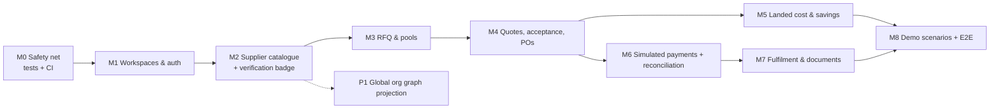

# Shinrai 信頼: Implementation Checklist (Trust-Backed Pooled Procurement)

Status: plan only. No application code has been changed. Baseline: commit `ad8ddb3`.
Design reference: [ARCHITECTURE_PROPOSAL.md](ARCHITECTURE_PROPOSAL.md). Product rationale: [UPGRADE_PLAN.md](UPGRADE_PLAN.md).

## 0. How to use this checklist

- Work the milestones in order. Inside a milestone, items without a dependency between them can run in parallel.
- **Estimates** assume one developer who knows this repo, with Python and React experience. "d" means a focused 6-hour day. They exclude partner negotiation, legal review and customer interviews. Every estimate is a guess until the first item lands.
- **Definition of done (applies to every item):** code merged; new strings in `i18n/en.json` and `ja.json` (no new inline `lang === "ja"` ternaries); listed tests pass; `python -m scripts.validate` still prints ALL PASS; `tsc -b --noEmit` and `vite build` pass; every demo or simulated record visibly labelled; DECISIONS.md updated if a choice was made.
- **Not allowed in any P0 item:** real money movement, real provider credentials, unlabelled synthetic data, claims of savings that are not computed from shown inputs.

### Decisions locked by this plan (so developers do not re-decide them)

| # | Decision | Where justified |
|---|---|---|
| L1 | Pooling model is **Model A**: shared negotiation, separate PO, invoice, payment and import per buyer | UPGRADE_PLAN §4 |
| L2 | Shinrai **never holds funds** in MVP or pilot. Payments are either the `simulated` provider (demo) or direct buyer-to-supplier bank payment with reconciliation | RESEARCH §4 |
| L3 | Commitment = conditional intent with a private price ceiling. The binding step is per-buyer PO acceptance of a `terms_hash` | ARCHITECTURE §5.2 |
| L4 | Money = integer minor units + ISO code. No floats in money paths | ARCHITECTURE §6 |
| L5 | New code lives in new packages and `routes_*.py` files. Existing investigation tables stay unchanged apart from nullable `workspace_id`/`org_id` columns | ARCHITECTURE §3.1, §4.4 |
| L6 | Stay on SQLite for the hackathon. Postgres and Alembic come at the pilot | ARCHITECTURE §11 |
| L7 | HS code and tariff rate are **user-entered, UNVERIFIED** until a broker confirms them. There is no automated tariff determination | UPGRADE_PLAN §6 |

### Blocking decisions that remain open (owner: product lead)

| # | Decision | Blocks | Default if not decided by M2 start |
|---|---|---|---|
| B1 | Demo product category (proposal: stainless fasteners, HS 7318, or machined auto components, HS 8708) | M2 seed, M5 landed cost | Stainless hex bolts, HS 7318.15 (illustrative) |
| B2 | Demo destination port and Incoterm | M5 | FOB Nhava Sheva → Yokohama, sea LCL |
| B3 | Shown platform fee model (none / buyer facilitation fee / supplier success fee) | M5 savings, M7 | **None shown** (the fee line reads "not charged in prototype") |
| B4 | Persona switcher vs real login for the demo | M1 | Persona switcher behind `DEMO_MODE=1` |

---

## 1. Milestone map

P0 total: about **17–23 developer-days** (see per-item figures). With two developers splitting backend and frontend, that is about **2.5 weeks** of calendar time. This is not a 30-hour hackathon scope. For a hackathon, cut to the **H-slice** in §5.

---

## 2. P0: the end-to-end slice

### M0: Safety net

**P0-01 Add pytest, a test DB fixture and CI**
- Value: none of the new money or state logic can be trusted without tests. Today there is no unit test suite and no CI (only `backend/scripts/validate.py`).
- Files: new `backend/tests/conftest.py`, `backend/requirements-dev.txt` (`pytest`, `hypothesis`), `.github/workflows/ci.yml`.
- Changes: the fixture sets `SHINRAI_DB` to a tmp path before importing `app`. CI runs `pytest`, `python -m scripts.validate`, `npm ci && npx tsc -b --noEmit && npx vite build`.
- Dependencies: none. Effort: 0.5 d.
- Acceptance: CI green on main. A deliberately failing test turns CI red.
- Tests: a smoke test that `GET /api/meta` returns 200.
- Failure handling: CI caches pip and npm. Network flakiness → retry once.
- Security: CI holds no secrets.

**P0-02 Decouple optional heavy imports**
- Value: `app.main` cannot start without `pandas`/`numpy`, because `routes_master.py:13` → `intel/distress.py:11-12` imports them at module level even when the distress model is off. This was verified while running validate in a minimal venv. It makes tests and the slim deploy fragile.
- Change: move the `numpy`/`pandas` imports inside the functions that use them in `intel/distress.py`.
- Effort: 0.25 d. Acceptance: `python -c "import app.main"` works with only the core requirements installed (analytics is still optional).
- Tests: CI job with core requirements only.

### M1: Workspaces, auth and tenancy

**P0-03 Workspace, User and Membership models plus demo login**
- Value: an SME must not see another SME's RFQs, quantities, invoices or payments. Today `GET /api/sme` (`main.py:93`) lists every SME, and every route is unauthenticated.
- Files: new `backend/app/auth.py`, `backend/app/routes_auth.py`. Models in `auth.py` or `models.py`. Wire into `main.py`.
- Schema: `Workspace`, `User`, `Membership`, `SessionToken(token_hash, user_id, expires_at)`. Nullable `Sme.workspace_id`.
- API: `POST /api/auth/demo-login {persona}` (only when `DEMO_MODE=1`), `GET /api/me`, `POST /api/auth/logout`.
- UI: persona switcher in `Shell.tsx` (Buyer A, Buyer B, Buyer C, Supplier, Ops), shown only in demo mode with the label "Demo personas". Token kept in memory plus `sessionStorage`. `lib/api.ts` adds an `Authorization` header.
- Effort: 1.5 d. Dependencies: P0-01.
- Acceptance: with `DEMO_MODE=0`, demo-login returns 404. Tokens are random 32 bytes, stored hashed, and expire after 12 h.
- Tests: login, `/me`, expired token → 401, unknown persona → 400.
- Security: tokens are never logged. Rate limiting arrives in P1-07.

**P0-04 Scope existing routes and add the authorisation guard pattern**
- Value: one consistent pattern that every new module reuses.
- Change: `current_principal` dependency. `require_workspace(principal, workspace_id, roles)` helper. Apply to `/api/sme*`, `/api/partners*`, `/api/investigations*`, `/api/compare`. Existing demo data moves into a shared "Demo" workspace that every demo persona can read, so the trust demo keeps working.
- Effort: 1.5 d. Dependencies: P0-03.
- Acceptance: Buyer A cannot read Buyer B's SME, partners or investigations (403). The demo workspace still runs scenarios A to E.
- Tests: a parametrised cross-tenant test over every GET route, asserting 403/404.
- Risk: the SSE stream and the PDF print routes are fetched by Playwright and the browser `EventSource`, which cannot send headers. Use a short-lived signed `?st=` query token for those two routes only.

### M2: Supplier catalogue and verification badge

**P0-05 SupplierProfile, Product, PriceTier, Certification models and CRUD**
- Files: `backend/app/catalogue/models.py`, `backend/app/routes_catalogue.py`.
- API: `GET /api/suppliers`, `GET /api/suppliers/{ref}`, supplier-only `POST/PUT /api/supplier/products`, `PUT …/tiers`.
- Validation: `moq_qty > 0`. Tiers strictly increasing in `min_qty` with non-increasing unit price (warn, do not reject, if the price increases). One currency per product. Incoterm from the Incoterms 2020 list.
- Effort: 1.5 d. Dependencies: P0-04.
- Acceptance: a supplier persona creates a product with 3 tiers. A buyer sees it only when `published`. Prices are stored as integers.
- Tests: tier validation, publish visibility, cross-supplier edit → 403.

**P0-06 Deterministic verification badge from investigations**
- Value: connects the existing trust engine to sourcing. "Verified" gets a defined meaning.
- Files: `backend/app/catalogue/badge.py`.
- Rule (data, in `rulebook.yaml` under a new `supplier_levels` key):
  - **L0 Listed**: self-declared, no investigation.
  - **L1 Registry-checked**: an investigation within 180 days where identity resolved in LIVE or CACHED mode and the band is not `insufficient`.
  - **L2 Verified**: L1, plus no critical or high flags, plus GST checked (not "not checked").
  - **L3 Audited**: L2 plus a completed Genba audit with no failed items.
  - An illustrative (SEED) investigation can never give more than "L1 (illustrative)".
- Output: `{level, label_en, label_ja, verified_at, expires_at, inv_id, mode, reasons[]}`.
- UI: a `SupplierBadge` component that links to `/report/{inv_id}` and shows the date, mode chip, and a "what this means" popover.
- Effort: 1 d. Dependencies: P0-05.
- Acceptance: Maruti (CACHED) → L2. Sunrise (SEED, high flags) → L0 with reasons. Kaveri (SEED, standard) → "L1 (illustrative)".
- Tests: a table test per level and for expiry at day 181.

**P0-07 Buyer supplier-discovery screen**
- UI: new route `/source` in `main.tsx`, page `pages/Source.tsx`. Filter by category, state and minimum badge level. Cards show the badge, MOQ, tier preview, lead time and an "open pools" count. Inline glossary chips explain MOQ, Incoterm and HS code.
- Effort: 1.5 d. Dependencies: P0-05, P0-06.
- Acceptance: when data is missing (no tiers, no investigation), cards show "Not provided" or "Not verified", never blanks. Every card shows the provenance chip.
- Tests: a Playwright smoke test that the page renders the seeded suppliers.

**P0-08 Seed: illustrative suppliers and products**
- Files: extend `backend/scripts/make_seed.py` or add `scripts/make_trade_seed.py`. Data goes in `data/seed/trade/*.json`, all `is_demo: true`.
- Content: 3 suppliers.
  - S1 is linked to an existing synthetic company with a clean profile. Add a new synthetic "clean" company in the seed. **Do not use Maruti as a supplier of fasteners**, because that would be a false commercial claim about a real company.
  - S2 is linked to Kaveri (illustrative mid-risk).
  - S3 has no investigation (L0).
  - 1 product category with 3 tiers each. All prices labelled "illustrative".
- Effort: 0.5 d. Dependencies: P0-05.
- Acceptance: no real company appears as a seller. All labels say illustrative.

### M3: RFQ and order pools

**P0-09 RFQ model, API and form**
- Files: `backend/app/procurement/models.py`, `backend/app/routes_procurement.py`, `pages/RfqNew.tsx`.
- Mandatory fields: category, product or free spec, qty, unit, destination port, delivery window, incoterm requested, certifications required, and a private max unit price (optional but needed to commit to a pool).
- Effort: 1 d. Dependencies: P0-05.
- Acceptance: an RFQ is visible only to its workspace. Missing mandatory fields come back as field-level bilingual errors.

**P0-10 Pool aggregate, state machine and compatibility key**
- Files: `backend/app/procurement/pool.py` (transition table plus pure functions).
- **Compatibility rule**: a buyer can join only if all of these match:
  - same `product_id`;
  - same `spec_hash`, where spec options are fully specified (grade, size, standard, finish, packaging);
  - same incoterm and named place;
  - same destination port;
  - the buyer's delivery window overlaps the pool's window by at least 14 days;
  - the buyer's required certifications are a subset of the product's register-verified certifications.
  
  Anything else → "not compatible", with the mismatched fields listed.
- Effort: 2 d. Dependencies: P0-09.
- Acceptance: the transition table matches ARCHITECTURE §5.1/5.2 exactly. Illegal transitions raise `409 {code:"illegal_transition"}`.
- Tests: an exhaustive table test of every (state, event) pair, and compatibility cases.

**P0-11 Join, commit, withdraw (concurrency- and idempotency-safe)**
- API: `POST /api/pools/{ref}/members`, `PATCH …/members/me`. `Idempotency-Key` required.
- Logic: SQLite `BEGIN IMMEDIATE`. Recompute committed total. Reject when it would exceed `max_total_qty` (`409 capacity_exceeded`, with the remaining qty). A withdraw before `closes_at` is free. After close, withdrawal is not allowed (the commitment lapses only via the state machine).
- Also: new `backend/app/events.py` (`DomainEvent` append with hash chain) and an `IdempotencyKey` table.
- Effort: 1.5 d. Dependencies: P0-10.
- Acceptance: 20 concurrent joins never exceed capacity. A replayed key returns the identical response. The same key with a different body → 409.
- Tests: a threaded concurrency test, idempotency replay, and event-chain verification (`verify_chain(aggregate)` returns True; it returns False after a manual row edit).

**P0-12 Pool deadline processor**
- Logic: a lazy evaluation `advance_if_due(pool)` runs on every read and write of the pool, plus an `asyncio` periodic task every 60 s in `main.py` startup. No new infrastructure.
- Effort: 0.5 d. Dependencies: P0-10.
- Acceptance: past `closes_at`, the pool moves to `QUOTE_PENDING` if committed ≥ min, else `FAILED_THRESHOLD`, and members become `LAPSED` with a notification event.
- Tests: freeze time (inject a `now` parameter) on both sides of the threshold.

**P0-13 Pool UI (buyer)**
- Route `/pool/:ref`. Shows:
  - a progress bar of committed (solid) vs interested (hatched) vs `min_total_qty`;
  - a member bucket ("3–5 buyers"), never names;
  - a tier ladder with the currently reached tier highlighted;
  - "your commitment" with an edit or withdraw control;
  - the deadline countdown;
  - a "What happens if the threshold isn't met" explainer;
  - the supplier badge.
- Each screen answers: what is happening, what action is needed, what is missing, what the financial commitment is, what could go wrong, and who acts next. Use the `StepBar` pattern from `components/StepBar.tsx`.
- Effort: 2 d. Dependencies: P0-11.
- Acceptance: a buyer cannot see another member's quantity or name. Copy states "Committing is not a purchase. You confirm a purchase order after the final quote."

### M4: Quotes, acceptance and purchase orders

**P0-14 Supplier quote versions and supplier mobile screen**
- API: `POST /api/pools/{ref}/quotes` builds the immutable `SupplierQuote` vN. `terms_hash` = sha256 of canonical JSON (tiers, incoterm, payment terms, lead time, validity).
- UI: `/s/rfq/:ref` is mobile-first (360 px). The supplier sees aggregate demand, member count bucket and delivery window, then confirms or edits tiers and terms and issues the quote. Large tap targets. English-first, with Japanese available.
- Effort: 1.5 d. Dependencies: P0-12.
- Acceptance: issuing vN+1 resets every `ACCEPTED` membership to `COMMITTED` (or `RELEASED` if over the ceiling), and each affected buyer gets an event.
- Tests: the re-quote reset and the hash stability.

**P0-15 Buyer acceptance plus auto-release over the ceiling**
- Logic: resolved unit price = the tier for the **accepted** total. When acceptances fall below the reached tier at window close → `REQUOTE` (ARCHITECTURE §5.1). If final price > a member's private ceiling, that member is `RELEASED` automatically.
- Effort: 1 d. Dependencies: P0-14.
- Acceptance: a buyer accepts only a specific `terms_hash`, and acceptance against a stale hash → `409 terms_changed`.
- Tests: tier drop on a late withdrawal, ceiling release, stale-hash rejection.

**P0-16 PO issuance and the PO state machine**
- Files: `procurement/models.py` (`PurchaseOrder`, `PoLine`), transitions per ARCHITECTURE §5.3.
- Logic: one PO per accepted member when the pool is `CONFIRMED`. The PO number looks like `PO-YYYY-NNNN` per buyer workspace. `buyer_is_importer_of_record = true` is shown on the PO.
- UI: `/orders/:ref`, the shared timeline for buyer and supplier, with "Responsible next: Supplier / You". Bilingual PDF through the existing Playwright printer (`routes_modules.py:_print`).
- Effort: 2 d. Dependencies: P0-15.
- Acceptance: cancelling Buyer A's PO does not change Buyer B's PO or the pool record. The PDF includes the terms hash and the "ILLUSTRATIVE / not a real order" watermark in demo.
- Tests: isolation of PO transitions and role guards (a supplier cannot mark DELIVERED).

### M5: Landed cost and net savings

**P0-17 Money module**
- File: `backend/app/money.py`. Covers ISO exponents (JPY 0, INR 2, USD 2), `Money` arithmetic with currency checking, `convert(money, fx_quote, rounding)`, and `allocate(total, weights)` with largest remainder.
- Effort: 0.5 d. Dependencies: P0-01.
- Acceptance and tests:
  - property test: `sum(allocate(t, w)) == t` for random inputs;
  - payable rounding is `ROUND_CEILING` for the payee-protected direction;
  - mixing currencies raises an error.

**P0-18 Landed-cost estimator (pure, explainable)**
- File: `backend/app/procurement/landed_cost.py`.
- Each line is `{label_en, label_ja, amount: Money|None, status: CONFIRMED|QUOTED|ESTIMATE|UNKNOWN|NEEDS_PROFESSIONAL, basis, source_url?}`.
- Lines:
  - goods (tier price × qty);
  - origin charges if the incoterm requires them;
  - international freight (manual quote input; shared freight allocated by chargeable weight);
  - insurance (input, or "UNKNOWN");
  - customs value basis = CIF (Japan);
  - import duty = user-entered rate × CIF, status NEEDS_PROFESSIONAL unless broker-confirmed. A CEPA preferential rate requires the "CoO available" flag and is still NEEDS_PROFESSIONAL;
  - import consumption tax, computed on (CIF + duty) at the configured rate and **shown separately as normally creditable for taxable businesses**, so it is excluded from "savings";
  - broker fee, domestic delivery and payment fees (inputs);
  - platform fee (per B3).
- `total_status` = the worst line status. `INCOMPLETE` if any line is UNKNOWN.
- Three scenarios:
  1. **Independent**: the buyer's own qty, at the tier its qty alone reaches, with its own freight. If its qty is below MOQ → "not purchasable, MOQ not met".
  2. **Pooled, separate logistics**.
  3. **Pooled with shared logistics** (only if the buyer opts in and the shipment is consolidated).
- Effort: 2 d. Dependencies: P0-17.
- Acceptance: savings are shown **per category** (goods, freight, fixed fees). Duty is shown separately and only follows from the goods value. The tax line is never counted. Any UNKNOWN input → savings shown as "partial" with the missing items listed.
- Tests: golden fixtures with hand-computed expected values; the MOQ-not-met baseline; a missing freight quote → INCOMPLETE.

**P0-19 Savings panel UI**
- Component `LandedCostCompare.tsx` on `/pool/:ref` and `/orders/:ref`. Columns for the 3 scenarios, rows by category, a status chip per cell, and a footer stating the baseline definition and that figures are estimates.
- Effort: 1 d. Dependencies: P0-18.
- Acceptance: no headline "you save ¥X" unless `total_status` is not INCOMPLETE. Otherwise show "Goods cost saving ¥X (other costs incomplete)".

### M6: Payments (SIMULATED) and reconciliation

**P0-20 Provider protocol plus the simulated provider**
- Files: `backend/app/payments/{models.py, provider.py, simulated.py}`, `backend/app/routes_payments.py`.
- Protocol: `quote(sell_ccy, buy_money) -> FxQuote`, `initiate(intent) -> provider_payment_id`, `parse_webhook(headers, body) -> ProviderEvent` (verifies HMAC-SHA256 with timestamp tolerance ±5 min).
- Simulated provider:
  - the FX rate comes from a fixed config value labelled `SIMULATED`. **Never present it as a market rate.**
  - quote validity is 15 min;
  - it sends events to our own webhook only when ops triggers `POST /api/ops/payments/{ref}/simulate {outcome: settled|failed|reversed}`.
- Effort: 2 d. Dependencies: P0-16, P0-17.
- Acceptance: an expired quote cannot be initiated (`409 quote_expired`). A double submit with the same idempotency key creates exactly one intent. A webhook with a bad signature → 401 and is stored with `signature_valid=false`, with no state change. A duplicate `provider_event_id` → 200 and is ignored.
- Tests: all of the above, plus out-of-order events (`settled` before `pending`) applied safely per the transition table.

**P0-21 Payment UI**
- Route `/pay/:poRef`. Shows:
  - the supplier invoice amount (INR) and invoice reference;
  - the JPY payable, rate, timestamp and expiry countdown;
  - the fee list with statuses;
  - an explicit **excluded costs** list;
  - a "Payment path" box: "SIMULATED provider: no money moves. In the pilot, payment is a bank transfer from your bank to the supplier's Indian bank (AD bank)."
- After initiation, a status timeline driven by `ProviderEvent`s.
- Effort: 1.5 d. Dependencies: P0-20.
- Acceptance: the SIMULATED banner sits on every payment surface (reuse `SimulatedBanner` from `MoneyPanel.tsx`). Nothing on screen says "paid" until the intent is `SETTLED`.

**P0-22 Reconciliation record**
- Logic: on `SETTLED`, create `Reconciliation(expected, received)` with status matched, short or over. A short payment → PO stays `AWAITING_ADVANCE` and an ops alert appears.
- Effort: 0.5 d. Dependencies: P0-20.
- Tests: matched, short and over cases.

### M7: Fulfilment and documents

**P0-23 Shipment, allocation and trade documents**
- Files: `backend/app/logistics/models.py`, `backend/app/routes_logistics.py`.
- Supplier actions: mark ready (requires a commercial invoice and packing list upload), mark shipped (requires a B/L or AWB number plus upload). Buyer actions: confirm delivered, open dispute.
- Uploads: magic-byte check, PDF/PNG/JPEG only, ≤ 10 MB, random filename, sha256 stored, authorised download only.
- Effort: 1.5 d. Dependencies: P0-16.
- Acceptance: a document is visible only to the PO parties and ops. A file of the wrong type is rejected with a bilingual message.
- Tests: upload validation and access control.

**P0-24 Order timeline UI for buyer and supplier**
- Shows each event with actor, time and evidence (document link or provider event). Highlights "Responsible next". Mobile layout for the supplier.
- Effort: 1 d. Dependencies: P0-23.

### M8: Demo scenarios and E2E

**P0-25 Scripted demo seed for 4 scenarios** (all ILLUSTRATIVE)
1. **Positive**: pool for stainless bolts. Buyers A, B and C commit 12k, 18k and 25k against a 50k tier. The supplier quotes, all accept, 3 POs are issued, Buyer A pays (simulated settled), and the order ships.
2. **Unavailable data**: S3 (no investigation) shows L0 and "Not verified". The landed cost has the freight quote missing → INCOMPLETE.
3. **Failed pool**: a second pool reaches 31k of 50k by the deadline → `FAILED_THRESHOLD`. Members lapse, with no obligations and no charges.
4. **Failed payment / cancelled order**: Buyer B's simulated payment fails → retry with a new quote after expiry. Buyer C cancels before supplier acceptance, and the other POs are unaffected.
- Files: `scripts/make_trade_seed.py`, a `POST /api/demo/trade-setup` endpoint (demo only), and new cards on `pages/Demo.tsx`.
- Effort: 1 d. Dependencies: M1 to M7.

**P0-26 Playwright E2E for the 4 scenarios, plus the existing trust demo**
- Effort: 1.5 d. Dependencies: P0-25.
- Acceptance: all 4 trade scenarios and existing scenarios A to E pass headless in CI.

---

## 3. P1: pilot features (need partners, interviews or production infrastructure)

| ID | Title | Value | Depends on | Est. | External needs |
|---|---|---|---|---|---|
| P1-01 | Global org graph projection (`Org`, `OrgIdentifier`, `OrgRelationship`) plus backfill script | Persistent cross-company graph with provenance and visibility | P0-04 | 3 d | — |
| P1-02 | Relationship view on the supplier page (verified / reported / inferred / stale / unavailable legend) | Evidence-backed commercial context | P1-01 | 2 d | — |
| P1-03 | Postgres plus Alembic baseline, `SHINRAI_DB_URL` | Pilot reliability, real concurrency | P0 done | 2 d | Managed Postgres |
| P1-04 | Real login (email magic link), invites, roles | Pilot users | P0-03 | 2 d | Email provider |
| P1-05 | "Direct bank transfer" payment path: payment instruction PDF, proof-of-payment upload, supplier confirms receipt, reconciliation | Real payments without Shinrai touching funds | P0-20 | 2 d | Legal review (RESEARCH Q-list) |
| P1-06 | First regulated provider adapter behind `Provider` | Better FX and status | P0-20 | 5–10 d | Partner contract, KYB, sandbox keys |
| P1-07 | Rate limiting, audit-log viewer for ops, upload malware scan (ClamAV) | Security baseline | P0 | 2 d | — |
| P1-08 | IEC verification adapter (DGFT) plus GST live provider for suppliers | Stronger badge | P0-06 | 1–2 d | API access / terms |
| P1-09 | JP buyer verification via the NTA corporate number (法人番号) Web-API | Buyer trust for suppliers | P0-03 | 1 d | NTA application ID |
| P1-10 | Broker-confirmed HS and duty field, document checklist per HS chapter | Landed-cost confidence | P0-18 | 2 d | Customs broker partner |
| P1-11 | Workspace SSE stream for live pool and order updates | UX | P0-11 | 1 d | — |
| P1-12 | Move all inline `lang === "ja"` strings (134 occurrences) into i18n JSON | Maintainability, translation QA | — | 2 d | Native reviewer |
| P1-13 | Supplier reviews (verified-purchase only, labelled as buyer opinion) | Reputation | P0-16 | 1.5 d | — |
| P1-14 | Repeat order from a completed PO | Retention | P0-16 | 1 d | — |
| P1-15 | Pilot metrics dashboard (pool formation, quote time, net savings vs baseline) | Evidence for the business case | P0 | 2 d | — |

## 4. P2: future

- Model B consolidated logistics with a forwarder partner (house B/L, allocation from actual invoices).
- Model C central importer: needs a legal entity, inventory, tax registration and working capital. Only consider it if interviews show buyers want it.
- Wider Asia corridors, multi-country org identifiers.
- Continuous monitoring of suppliers (PRD F14), with alerts on status changes feeding the badge.
- Trade-finance integrations (L/C issuance via bank APIs, NEXI or ECGC coordination).
- Graph database. Only consider it if measured multi-hop queries exceed budget (ARCHITECTURE §12).

---

## 5. Hackathon H-slice (if only 1 to 2 days remain)

Build only these, in this order, and say so on screen:
1. P0-05 and P0-08 (catalogue plus seed). Skip auth: every page shows a **"Prototype: no accounts"** banner and uses a persona query parameter.
2. P0-06 (badge from existing investigations).
3. P0-10, P0-11 and P0-12 (pool state machine and joins, no concurrency hardening beyond `BEGIN IMMEDIATE`).
4. P0-17 and P0-18 with fixtures (landed cost and savings).
5. P0-13, P0-19 and P0-25 scenarios 1 and 3 (pool UI, savings panel, positive plus failed pool).
6. One simulated payment status flip (P0-20 without webhooks: an ops button calls the transition function directly, labelled SIMULATED).

Deferred and stated in the pitch: auth (P0-03/04), POs, documents, reconciliation. The pitch must **not** claim tenant isolation in this slice.

---

## 6. Quality gates: acceptance tests with pass/fail outcomes

| ID | Test | Pass condition |
|---|---|---|
| QG-01 | Existing regression | `python -m scripts.validate` prints `ALL PASS` (baseline verified 2026-10-25: 21/21 fixtures, Sunrise 22 / Kaveri 72 / Maruti 100) |
| QG-02 | Tier resolution | qty 9,999 → no tier (below MOQ); 10,000 → tier 1; 50,000 → tier 2 |
| QG-03 | Capacity under concurrency | 20 threads each join 5k to a pool with max 60k → committed ≤ 60k and exactly 12 succeed |
| QG-04 | Idempotent join | Same key + same body twice → 1 membership, identical responses. Same key + different body → 409 |
| QG-05 | Deadline failure | `closes_at` passes with 31k/50k → pool `FAILED_THRESHOLD`, all memberships `LAPSED`, no PO, no PaymentIntent |
| QG-06 | Requote reset | Quote v2 issued → all v1 acceptances revert; accepting v1 → 409 `terms_changed` |
| QG-07 | Ceiling release | Final unit ₹12.10 vs ceiling ₹12.00 → member `RELEASED`, not ordered |
| QG-08 | PO isolation | Cancel Buyer C's PO → A's and B's POs unchanged; pool still `CLOSED` |
| QG-09 | Allocation exactness | ¥100,001 freight split over weights (1,1,1) → shares sum to ¥100,001 |
| QG-10 | Currency precision | INR 145,200.00 at rate 1.7832 JPY/INR, payable rounding ceiling → ¥258,921 (hand-computed: 145,200 × 1.7832 = 258,920.64 → 258,921) |
| QG-11 | Quote expiry | Initiate at `expires_at + 1s` → 409 `quote_expired` |
| QG-12 | Webhook security | Bad HMAC → 401, intent unchanged. Duplicate event ID → 200, single state change |
| QG-13 | Out-of-order events | `settled` then `pending` → final state SETTLED, `pending` recorded as ignored |
| QG-14 | Tenant isolation | Buyer A requests B's RFQ, PO, payment and document → 403/404 for all |
| QG-15 | Pool privacy | The pool JSON for a member contains no other workspace ID, name or quantity |
| QG-16 | Badge honesty | A SEED-only investigation never yields more than "L1 (illustrative)" |
| QG-17 | Incomplete landed cost | No freight quote → `total_status = INCOMPLETE`, UI shows no headline saving |
| QG-18 | Tax not counted as saving | The consumption-tax line is present but excluded from the savings sum |
| QG-19 | Localisation | Every new route renders in `ja` with no English fallback keys visible (key-coverage script) |
| QG-20 | Labels | Every demo pool, PO and payment surface shows an ILLUSTRATIVE or SIMULATED chip (Playwright selector check) |
| QG-21 | Mobile supplier | `/s/rfq/:ref` at 360×740 has no horizontal scroll and tap targets ≥ 44 px |
| QG-22 | Upload safety | A `.exe` renamed `.pdf` is rejected; a 12 MB PDF is rejected |
| QG-23 | Event chain | `verify_chain('po', id)` True; after a manual SQL edit, False |
| QG-24 | Build | `tsc -b --noEmit` exit 0 and `vite build` succeed (baseline verified 2026-10-25) |

---

## 7. Developer completion checklist

- [ ] M0: P0-01 CI · P0-02 import decoupling
- [ ] M1: P0-03 workspaces and login · P0-04 route scoping and guards
- [ ] M2: P0-05 catalogue · P0-06 badge · P0-07 discovery UI · P0-08 seed
- [ ] M3: P0-09 RFQ · P0-10 pool machine · P0-11 joins · P0-12 deadlines · P0-13 pool UI
- [ ] M4: P0-14 quotes · P0-15 acceptance · P0-16 POs
- [ ] M5: P0-17 money · P0-18 landed cost · P0-19 savings UI
- [ ] M6: P0-20 simulated provider · P0-21 payment UI · P0-22 reconciliation
- [ ] M7: P0-23 shipments and docs · P0-24 timeline UI
- [ ] M8: P0-25 scenarios · P0-26 E2E
- [ ] QG-01 … QG-24 green
- [ ] DECISIONS.md updated with L1 to L7 and the answers to B1 to B4
- [ ] README demo section updated (new scenarios, SIMULATED disclosures)

## 8. External dependencies and who must act

| Dependency | Needed for | Owner | Status |
|---|---|---|---|
| Japanese and Indian legal opinions on payment facilitation | P1-05, P1-06 | Founders + counsel | Not started |
| Regulated payment partner (bank, PA-CB, or JP funds-transfer operator) | P1-06 | Founders | Not started |
| Licensed customs broker in Japan | P1-10, landed-cost validation | Founders | Not started |
| Freight forwarder for India→Japan LCL quotes | Landed cost realism, Model B | Founders | Not started |
| 8–12 discovery interviews (see RESEARCH §6) | Go/no-go on pooling | Product lead | Not started |
| Native Japanese reviewer for procurement terminology | QG-19, PDFs | Product lead | Not started |
| data.gov.in key, GST provider key, NTA application ID | Badge strength | Tech lead | Optional keys exist in `.env.example`; NTA not yet |
